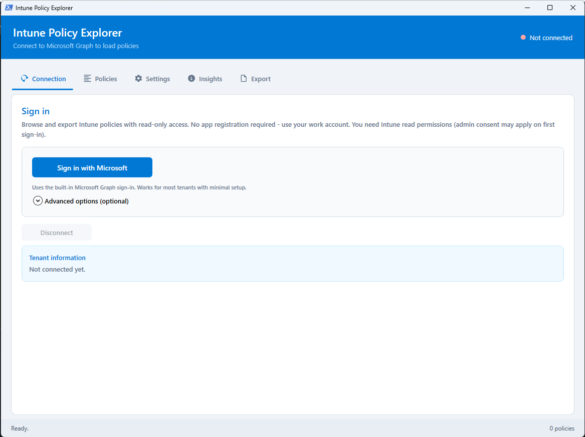
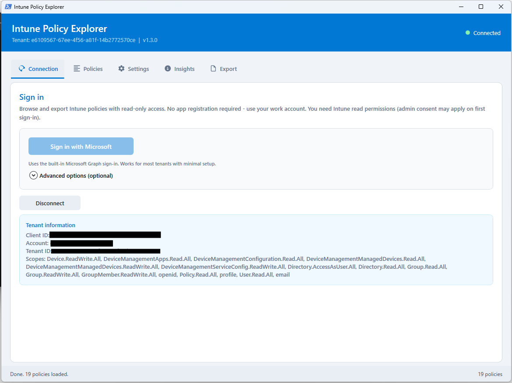
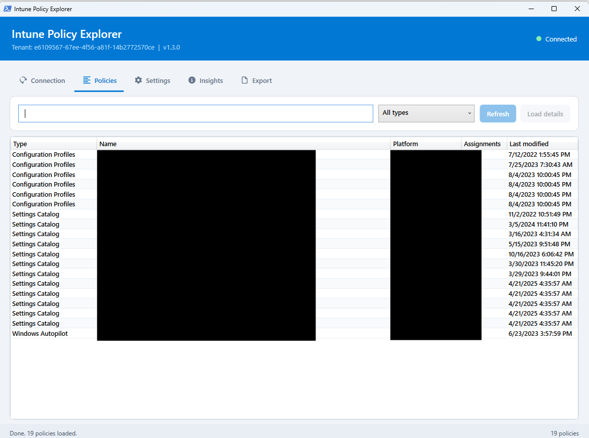
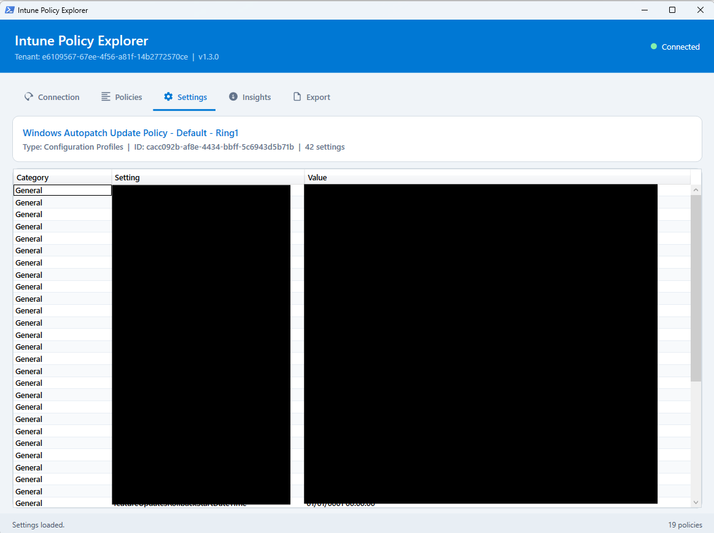
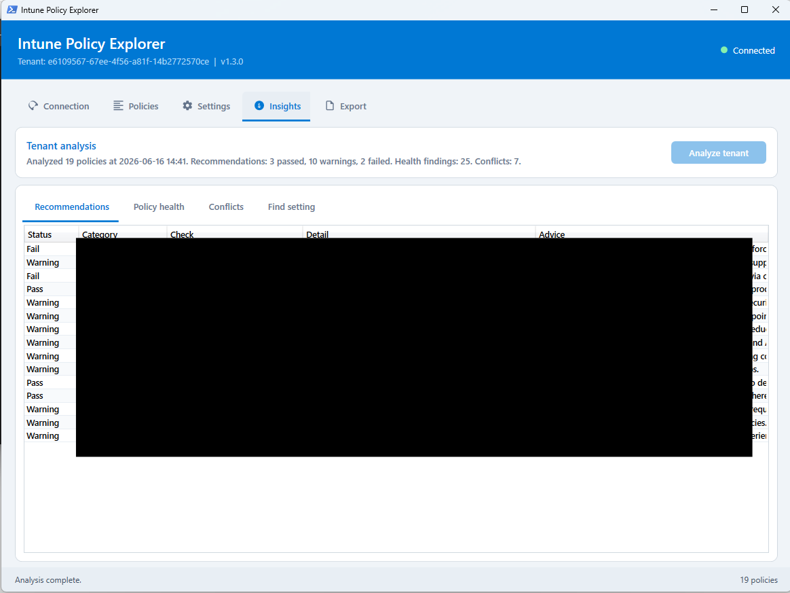
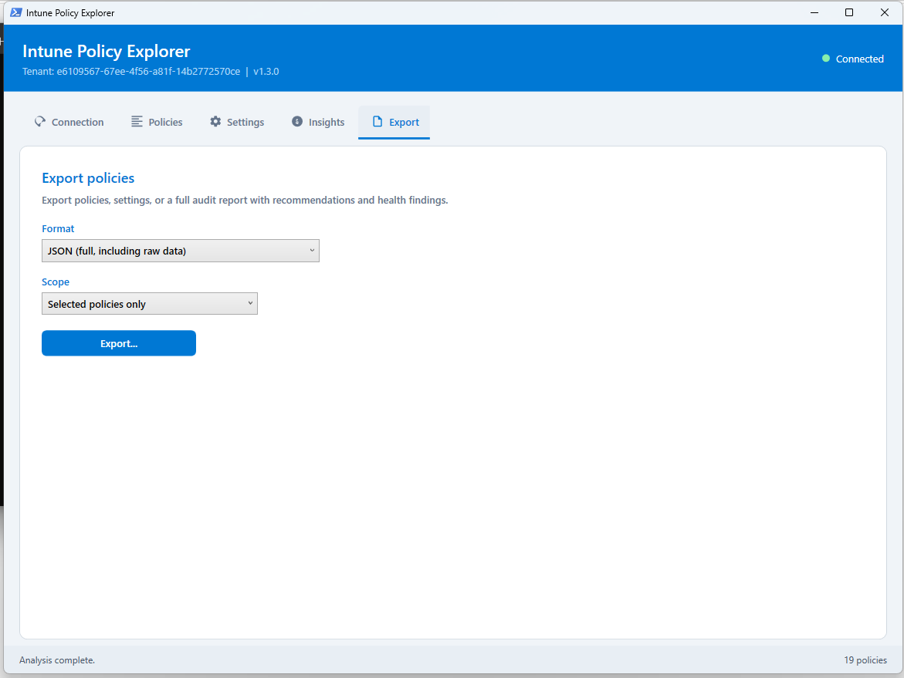

# Intune Policy Explorer

Open-source PowerShell GUI to **browse, analyze, search, and export** Microsoft Intune policies. Read-only — no policy changes.

[](https://www.powershellgallery.com/packages/IntunePolicyExplorer)
[](https://opensource.org/licenses/MIT)

- **Repository:** https://github.com/enginsoysal/IntunePolicyExplorer
- **Gallery:** https://www.powershellgallery.com/packages/IntunePolicyExplorer
- **License:** MIT

## Screenshots

### Connection — sign in



### Connection — signed in



### Policies — browse and filter



### Settings — inspect policy configuration



### Insights — recommendations, health, conflicts & search



### Export — JSON, CSV, HTML & audit report



## Quick start

```powershell
Install-Module IntunePolicyExplorer -Scope CurrentUser -Force
Show-IntunePoliciesGUI
```

Or run from source:

```powershell
git clone https://github.com/enginsoysal/IntunePolicyExplorer.git
cd IntunePolicyExplorer
.\Show-IntunePoliciesGUI.ps1
```

Click **Sign in with Microsoft**. No app registration required.

On first run, you are prompted to install `Microsoft.Graph.Authentication` if it is missing.

## Who is this for?

Intune administrators who need more than the Intune portal list view:

- **Discover** policies across all major Intune policy types
- **Inspect** settings per policy
- **Analyze** the tenant (recommendations, health, conflicts)
- **Search** settings across all policies (e.g. BitLocker, Defender)
- **Export** documentation and audit reports (JSON, CSV, HTML)

No custom Entra app registration is required for typical use.

## Features (v1.3.2)

| Area | What you get |
|------|----------------|
| **Policies** | Unified list with type, platform, assignments, last modified |
| **Settings** | Per-policy settings view from Microsoft Graph |
| **Insights** | Inventory recommendation checks (encryption, compliance, Defender, ASR, updates, Autopilot, MAM, …) |
| **Policy health** | Unassigned policies, stale policies (>12 months), duplicate names |
| **Potential conflicts** | Different values across distinct policies of the same type/platform/category; assignment overlap is not verified |
| **Find setting** | Cross-policy search by setting name or value |
| **Export** | JSON, CSV, HTML policy export + **HTML Audit Report** |

Click **Analyze tenant** on the Insights tab to run the full analysis (loads assignments and policy details).

## Understanding analysis results

Version 1.3.2 distinguishes an empty result from a failed request. Unreadable assignments remain **Unknown**; only a successful empty assignment response produces **Unassigned**. Source, assignment and settings failures appear in **Policy health**, the coverage summary and the HTML audit report. Expanded settings collections follow their own pagination links.

Recommendations are inventory hints, not a compliance score. **Info** means a policy or matching setting exists; it does not prove protection is enabled or deployed. **Warning** means no matching evidence was found in a fully collected inventory. **Unknown** means collection was incomplete. Potential conflicts require different policies and different values; effective group overlap, exclusions and filters are not evaluated. Comparisons stay within policy type/platform/category, so cross-type conflicts can be missed.

Long forms scroll, policy actions wrap, and the initial window fits the available Windows work area. At small window sizes, use the page scrollbar to reach lower controls and the table scrollbar to inspect additional columns.

## Requirements

- Windows 10/11, PowerShell 5.1+
- Work or school account with **Intune read access** (e.g. Intune Reader role or equivalent)
- Microsoft Graph **delegated read** permissions (requested on first sign-in):
  - `DeviceManagementConfiguration.Read.All`
  - `DeviceManagementApps.Read.All`
  - `DeviceManagementManagedDevices.Read.All`
  - `Policy.Read.All`

## Sign-in

### Default (recommended)

**Sign in with Microsoft** uses the built-in Microsoft Graph sign-in flow:

1. Browser or sign-in window opens
2. Sign in with your work account
3. Approve read permissions (admin consent may already exist in your tenant)
4. Policies load automatically

### Advanced options (optional)

Only needed when default sign-in is blocked by **Conditional Access** (e.g. device code flow blocked).

Expand **Advanced options** and provide your own Entra app:

- Tenant ID
- Client ID
- Scopes (optional — leave empty for recommended Intune read scopes)

## Supported policy types

- Configuration Profiles
- Settings Catalog
- Compliance policies
- Administrative Templates (ADMX)
- Endpoint Security
- Windows Autopilot
- App Protection (iOS / Android / Windows)
- Mobile App Configurations

Unavailable types are skipped with a warning (depends on your permissions).

## Export

| Format | Contents |
|--------|----------|
| **JSON** | Full policy + settings + raw Graph object |
| **CSV** | Policy overview + separate settings CSV |
| **HTML** | Readable per-policy documentation report |
| **HTML Audit Report** | Recommendations, health findings, conflicts, and full policy inventory |

Export selected policies or all loaded policies. The audit report always covers the analysis of the loaded inventory, including explicit coverage and collection errors.

## Troubleshooting

| Issue | What to try |
|-------|-------------|
| Device code blocked by CA | Use **Advanced options** with your own Entra app |
| Invalid scope error | Update module: `Update-Module IntunePolicyExplorer -Force` |
| Empty policy list | Disconnect and sign in again; approve all Intune read scopes |
| Analysis errors | Run **Refresh** on Policies tab first, then **Analyze tenant** |
| Sign-in window closes | Update Graph module: `Update-Module Microsoft.Graph.Authentication -Force` |

## Development

```powershell
git clone https://github.com/enginsoysal/IntunePolicyExplorer.git
.\Show-IntunePoliciesGUI.ps1
```

The GUI remains a self-contained script: `Show-IntunePoliciesGUI.ps1`. Module metadata, the loader, build scripts and regression tests are tracked to make releases reproducible.

Install from Gallery for production use:

```powershell
Install-Module IntunePolicyExplorer -Scope CurrentUser -Force
Show-IntunePoliciesGUI
```

## Reproduce and validate a release

On Windows, from the repository root:

```powershell
powershell.exe -NoProfile -File tests/Test-Analysis.ps1
pwsh.exe -NoProfile -File tests/Test-Analysis.ps1
powershell.exe -NoProfile -STA -File tests/Test-Collections.ps1
pwsh.exe -NoProfile -STA -File tests/Test-Collections.ps1
powershell.exe -NoProfile -STA -File tests/Test-Layout.ps1
powershell.exe -NoProfile -STA -File tests/Start-OfflinePreview.ps1 -RunChecks -Width 850 -Height 600
pwsh.exe -NoProfile -STA -File tests/Start-OfflinePreview.ps1 -RunChecks -Width 640 -Height 480
pwsh.exe -NoProfile -File scripts/Build-Release.ps1 -OutputDirectory dist/first
pwsh.exe -NoProfile -File scripts/Build-Release.ps1 -OutputDirectory dist/second
```

The tests require no tenant or Graph module. The GUI harness uses synthetic Graph responses with the production XAML, bindings, events and exporters. Layout tests check all tabs, expanded forms, button labels, clipping and hit testing in 12 viewport/scale combinations, plus the device-code helper. Scaling is simulated through available DIP space; it does not change Windows DPI settings. GUI test renders and a machine-readable layout report are written to `tests/results/`.

Compare `dist/first/SHA256SUMS.txt` and `dist/second/SHA256SUMS.txt`; they must match when built using the same PowerShell/.NET runtime. Builds normalize text encoding and line endings, use an explicit file allowlist, stable ZIP ordering and fixed entry timestamps. The package is under `dist/first/IntunePolicyExplorer/1.3.2/`, alongside the ZIP and SHA-256 checksums. No credentials or local publish helpers are packaged.

For an interactive offline preview, run `tests/Start-OfflinePreview.ps1`. Its sign-in button loads fake data and makes no Microsoft authentication request.

Before publishing, complete a real-tenant smoke test: sign in, refresh, inspect one policy of each accessible type, analyze and export the audit report. Verify native folder selection, keyboard navigation, and physical mouse clicks at the actual Windows DPI, including expanded advanced options. Automated fixture tests do not replace those checks.

Publish the validated module directory with `Publish-Module -Path ./dist/first/IntunePolicyExplorer/1.3.2 -NuGetApiKey $env:PSGALLERY_API_KEY`. Keep the key outside source control. Create a matching `v1.3.2` tag and GitHub release with the ZIP, checksums and changelog from the same tested commit. The validation workflow builds artifacts; it does not publish automatically.

## License

MIT License — Copyright (c) 2026 Engin Soysal.
